<p align="center">
  <picture>
    <source media="(prefers-color-scheme: dark)" srcset="docs/img/brand/lockup-1280.png">
    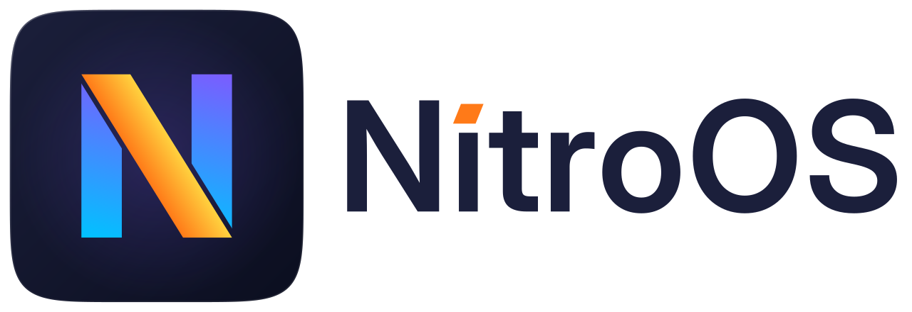
  </picture>
</p>

<p align="center"><b>An open-source, Windows-compatible operating system, built on ReactOS.</b><br>
NitroOS builds on ReactOS and adds what you need to use it every day: current 64-bit and 32-bit programs side by side, .NET Framework 4.8, PowerShell 7, NTFS as the default file system and a firewall that is switched on. Latest release: 2026.11-1.</p>

<p align="center">
  <a href="#download">Download</a> ·
  <a href="#screenshots">Screenshots</a> ·
  <a href="#quick-start">Quick start</a> ·
  <a href="#technical-details">Technical details</a> ·
  <a href="#known-limitations">Known limitations</a> ·
  <a href="#credits">Credits</a> ·
  <a href="CHANGELOG.md">Changelog</a> ·
  <a href="BENCHMARKS.md">Benchmarks</a>
</p>

<p align="center"><a href="docs/img/hero.webp">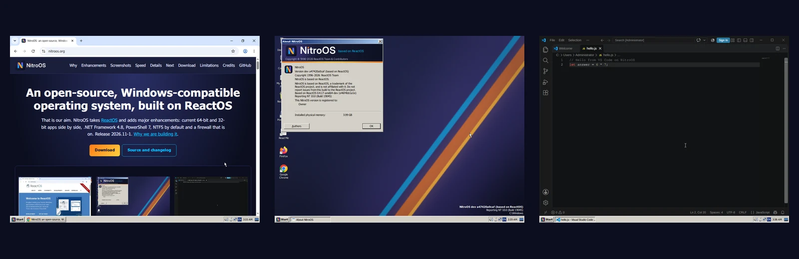</a></p>

> **NitroOS is based on [ReactOS](https://reactos.org) and is not affiliated with or endorsed by the ReactOS project.** ReactOS is a trademark of the ReactOS project. **Please report NitroOS problems here, not to ReactOS.**
>
> NitroOS is alpha software. Use it in a virtual machine, not on a disk with data you care about. We have tested it only under QEMU/KVM.

This repository (`nitroos-org/releases`, formerly "reactos-nitro") publishes the NitroOS releases: the installation ISOs, the source code of each release, the changelog and the benchmarks. Development happens in [nitroos-org/reactos](https://github.com/nitroos-org/reactos).

**Latest release: `2026.11-1` (9 November 2026)**, based on ReactOS commit [`e46f4bb1a1e`](https://github.com/reactos/reactos/commit/e46f4bb1a1ea7c722f941231565144fe0c286d3e), with 592 changes since 2026.10-5. Unless a section says otherwise, everything on this page refers to that release.

## Why NitroOS

We want an open-source operating system that runs Windows programs well enough to use every day. Building that by hand takes decades: ReactOS has been working on it since 1998, and NitroOS is built on that work. With AI coding agents doing the engineering under a human maintainer, we believe it can take months instead. Our first release came out on 20 October 2026. Three weeks and six releases later, Chrome, Firefox, Edge, VS Code, PowerShell 7 and .NET Framework 4.8 programs run on it.

- **Made for everyday use.** We work first on the programs people actually use, the system is ready to use straight after installation, and we release every week or two.
- **Proven, not promised.** We publish our benchmarks, including the tests where we are slower, and we show what works with screenshots.
- **Built with care.** NitroOS behaves the way Windows does and uses only clean, public sources. Every change is reviewed by a second AI model and tested before it is accepted.

**Our end goal is to merge all relevant work back into ReactOS.** ReactOS does not accept AI-generated code today, and we respect that. If its policy changes, we want this work upstream. Until then, NitroOS is a separate open-source (GPL) project; our [AI policy](https://github.com/nitroos-org/.github/blob/main/AI-POLICY.md) explains how we work.

## Major enhancements

What NitroOS adds to ReactOS, as of release 2026.11-1.

| | |
|---|---|
| **Apps** | |
| Current apps | Chrome 157, Firefox 159, Edge, VS Code 1.145 and PowerShell 7.6 install and work. Edge runs with its security sandbox switched on. ([screenshots](#screenshots)) |
| 32-bit and 64-bit programs together | The 64-bit version also runs 32-bit programs, as Windows does. You can run 64-bit and 32-bit Firefox at the same time; Task Manager marks the 32-bit ones with `*32`. ([screenshots](#screenshots)) |
| .NET Framework 4.8 and PowerShell 7 | Programs written for .NET Framework 4.8 run. PowerShell 7 comes preinstalled, including its network, storage, scheduled-task and local-account modules. ([screenshots](#screenshots)) |
| Recognised as Windows 10 | NitroOS reports itself as Windows 10 (version 10.0, build 19045), so installers that check the Windows version carry on instead of refusing. ([screenshots](#screenshots)) |
| Optional features | The Features dialog (or `featmgr` on the command line) installs extras with one click: PowerShell 7, the Scoop package manager, .NET Framework 4.8, Firefox, an AAC audio decoder, software 3D graphics and WinFsp. ([screenshots](#screenshots)) |
| Terminals and scheduled tasks | Modern terminals work: the VS Code terminal, Windows Terminal and PowerShell 7. Scheduled tasks run, so programs can keep themselves up to date. |
| **System** | |
| All your CPUs and memory | Multi-processor support is on by default in both the 32-bit and 64-bit versions, and a 4 GB machine shows 3.99 GB of usable memory. ([screenshots](#screenshots)) |
| Memory paging | On 64-bit, memory that programs are not using is moved to the paging file, so more programs fit. A program that asks for too much memory gets an error instead of bringing down the whole system. |
| Much faster memory handling | Up to 134 times faster than the ReactOS code it builds on, in our benchmarks. ([numbers](#speed)) |
| Accurate time in virtual machines | The clock stays accurate even under heavy load (drift of 0.004% or less). |
| **Files and storage** | |
| Disk Management | A Windows 7-style Disk Management tool that draws each disk and its partitions. Right-click a partition to create, format, extend or shrink a volume or change its drive letter, or set up a new disk as MBR or GPT. If an option is greyed out, the status bar tells you why. Before it changes anything, it checks that the disk is still the way you saw it, and afterwards it checks the result. |
| NTFS by default | A full read/write NTFS driver, based on the Linux kernel's NTFS code, with a journal that recovers the disk after a power cut, and a disk checker. Setup selects NTFS for you. ([screenshots](#screenshots)) |
| Btrfs | Updated to WinBtrfs 1.10, with our own fixes: disks formatted on current Linux systems open, `format /FS:BTRFS` works, and drive letters stay the same. |
| WinFsp | WinFsp installs, so file systems written as ordinary programs can be mounted as drive letters or network paths. |
| **Devices and graphics** | |
| A dependable Device Manager | A device you disable stays disabled after a restart (the boot disk is protected from this). If enabling or disabling a device fails, you are told. Installing a new driver for a running device restarts the device so the new driver takes effect. Driver installation runs in a protected system service. |
| Graphics | A display driver for virtio-gpu virtual machines, optional software OpenGL and Vulkan on 64-bit, and the first parts of Windows' modern composition interfaces, enough for WebView2 and Edge to draw their windows. |
| **Networking and security** | |
| A firewall that is on | The firewall is on from the first boot. It filters incoming and outgoing traffic, stores its rules the same way Windows does, has the usual Control Panel and Advanced Security tools, and asks you when a blocked program tries to accept connections. ([screenshots](#screenshots)) |
| Networking without administrator rights | Programs running as a standard user can use the network normally. `ipconfig` and `net` show the same output as on Windows, and the HTTP Server API, `netsh portproxy` and TLS through schannel work. |
| Security hardening | Permissions on the registry, many security fixes across the kernel, the graphics subsystem and networking, and browsers that run inside their security sandbox. |
| **Desktop** | |
| A nicer desktop | Sharper LCD text, extra open fonts, a Windows-style crash report dialog, copy and paste in the console with Ctrl+C and Ctrl+V or the mouse, and Windows installed to `C:\Windows`. |

### Speed

How NitroOS compares with the ReactOS code it is built on: the same test program on the same virtual machine, using the 32-bit version of both. Each row shows how much faster or slower NitroOS is.

| Test | ReactOS | NitroOS | NitroOS is |
|---|--:|--:|---|
| **Memory** | | | |
| Getting new memory (page faults per second) | 8,500 | 1,142,000 | 🟢 **134× faster** |
| Copy-on-write memory (page faults per second) | 6,700 | 447,000 | 🟢 **66× faster** |
| Memory-mapped files (page faults per second) | 42,900 | 1,115,000 | 🟢 **26× faster** |
| Heap: 1 million allocations and frees | 1.60 s | 0.15 s | 🟢 **10.6× faster** |
| VirtualAlloc: 32,768 commits and decommits | 69 ms | 13 ms | 🟢 **5.2× faster** |
| Heap: 4 threads allocating at once ‡ | 0.45 s | 12.2 s | 🟠 **27× slower** |
| **Programs** | | | |
| Boot to the logon screen | 10 s | 6 s | 🟢 **1.7× faster** |
| Start `cmd.exe` 50 times † | 0.60 s | 0.29 s | 🟢 **2.1× faster** |
| Start 200 processes and wait for each † | 1.69 s | 0.58 s | 🟢 **2.9× faster** |
| 7-Zip built-in benchmark (MIPS, higher is better) † | 3,444 | 22,640 | 🟢 **6.6× faster** |
| Two threads signalling each other ‡ | 51 ms | 583 ms | 🟠 **11× slower** |
| **Files** | | | |
| Read 10,000 small files (FAT) | 95 ms | 183 ms | 🟠 **1.9× slower** |

† These tests use several CPUs. The 32-bit ReactOS build uses only one CPU by default, while NitroOS uses all four, so part of the gain comes from the extra CPUs.

‡ Measured on a development build from before release 2026.11-1. The release's heap and lock improvements make the 4-thread heap test about 30 times faster; the benchmarks will be re-run for 2026.11-2. Small-file reads are being worked on for the same release.

How we measured: on 8 November 2026, on one host (AMD EPYC 9254, QEMU/KVM), with 4 virtual CPUs and 4 GB of memory, taking the median of 5 runs, with both systems on FAT. ReactOS: upstream master `4d1f0148bed`. NitroOS: development build `a690f0ba892`. Per-run spread and the full method: [`BENCHMARKS.md`](BENCHMARKS.md).

## Screenshots

NitroOS 2026.11-1 (64-bit, with NitroOS branding) on a freshly installed virtual machine with 4 CPUs, 4 GB of memory and a 1024x768 screen. These are unedited screen captures. Click a picture to see it full size.

| | |
|---|---|
| <a href="docs/img/nitro-desktop.webp">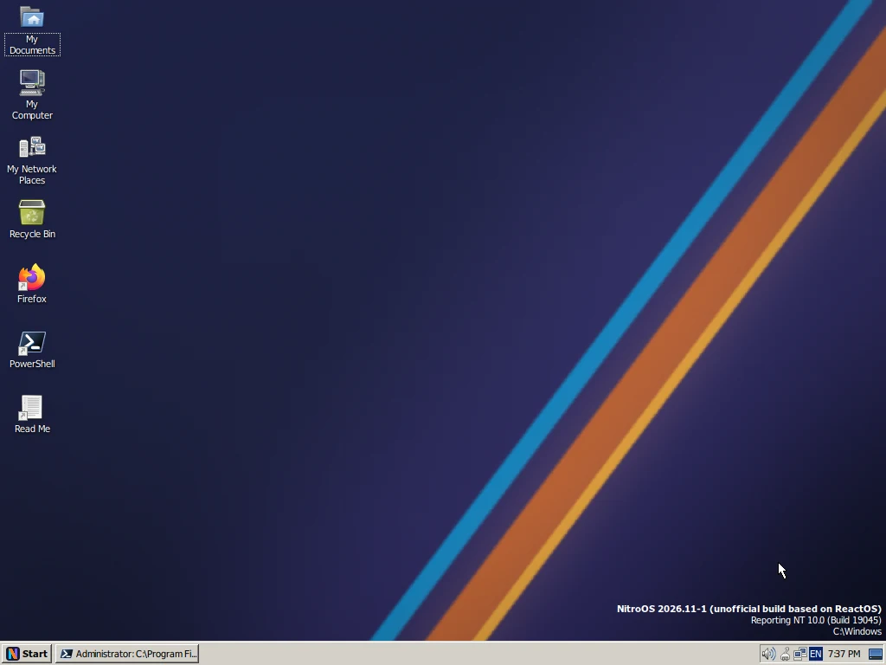</a><br>The desktop | <a href="docs/img/nitro-winver.webp">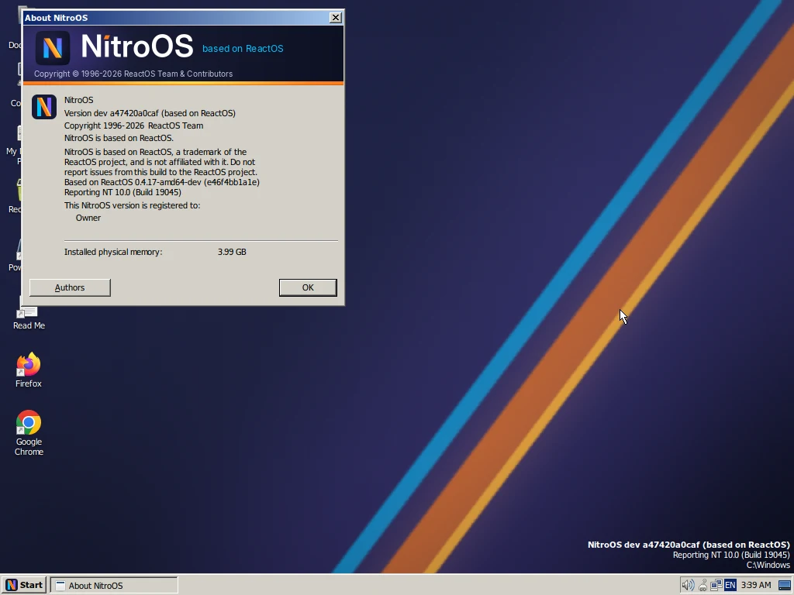</a><br>About NitroOS: Windows version 10.0, build 19045, with 3.99 GB of 4 GB of memory usable |
| <a href="docs/img/nitro-browser.webp">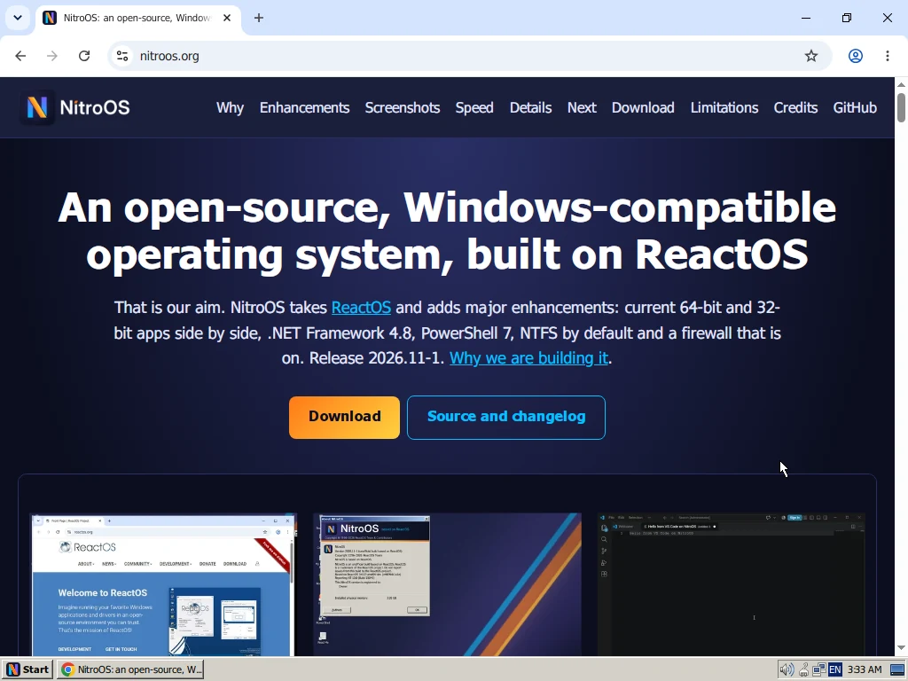</a><br>Chrome 157 showing a website | <a href="docs/img/nitro-firefox-64-32.webp">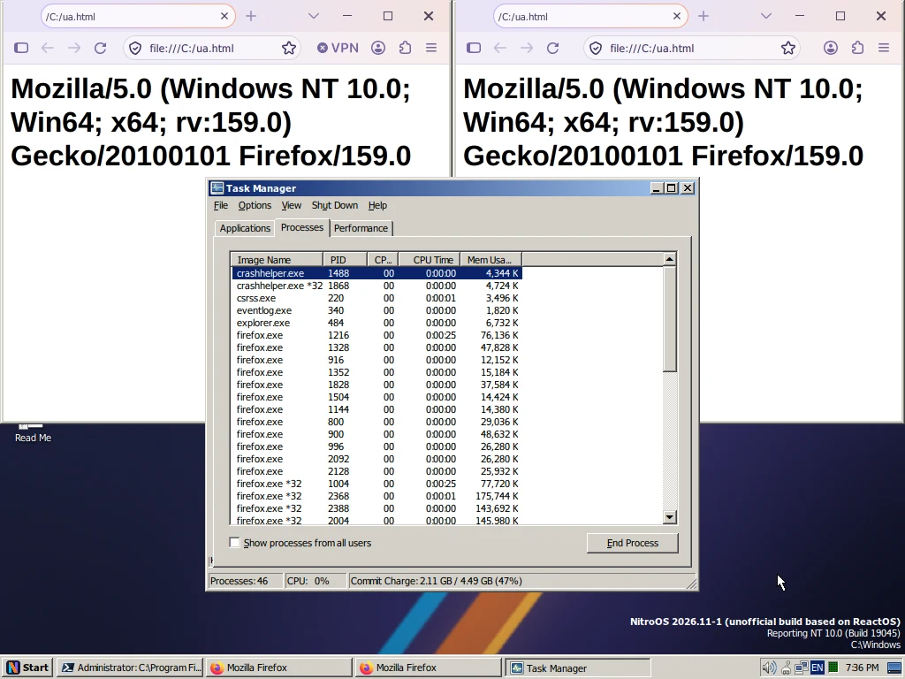</a><br>64-bit and 32-bit Firefox running together; Task Manager marks the 32-bit processes with `*32` |
| <a href="docs/img/nitro-vscode.webp">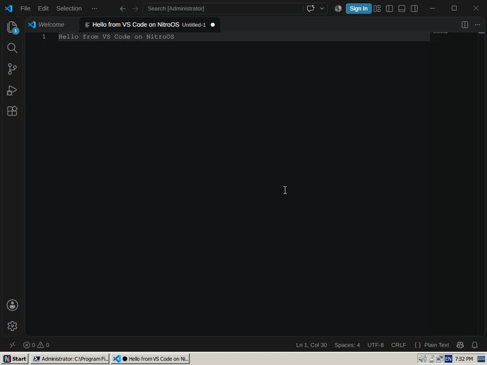</a><br>Visual Studio Code 1.145 | <a href="docs/img/nitro-powershell7.webp">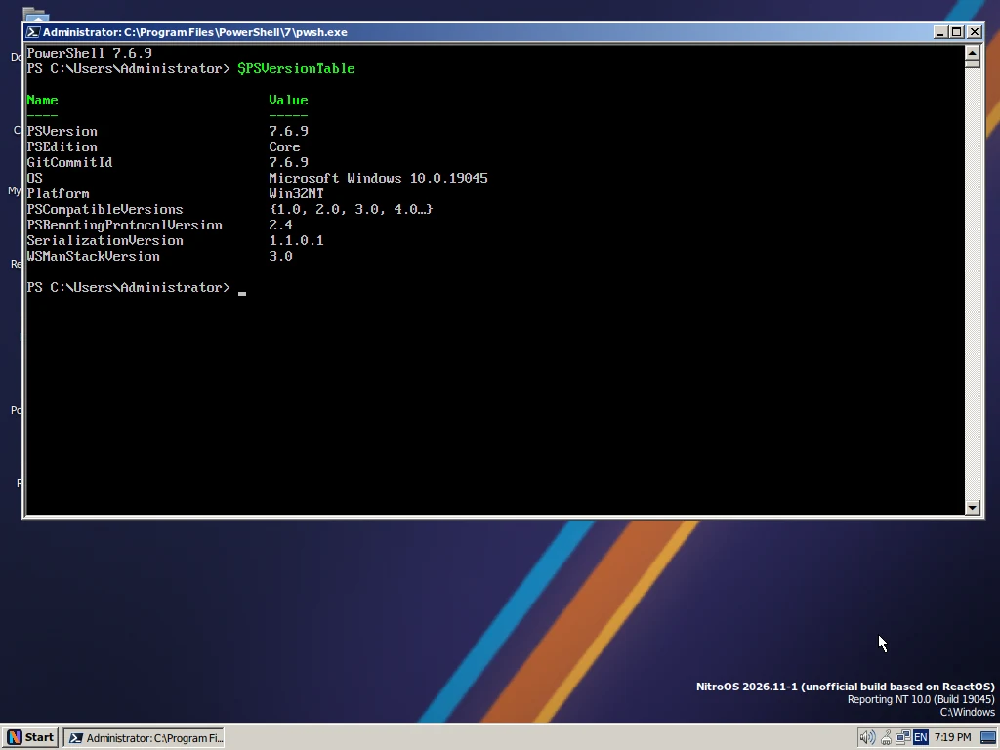</a><br>PowerShell 7.6 |
| <a href="docs/img/nitro-dotnet.webp">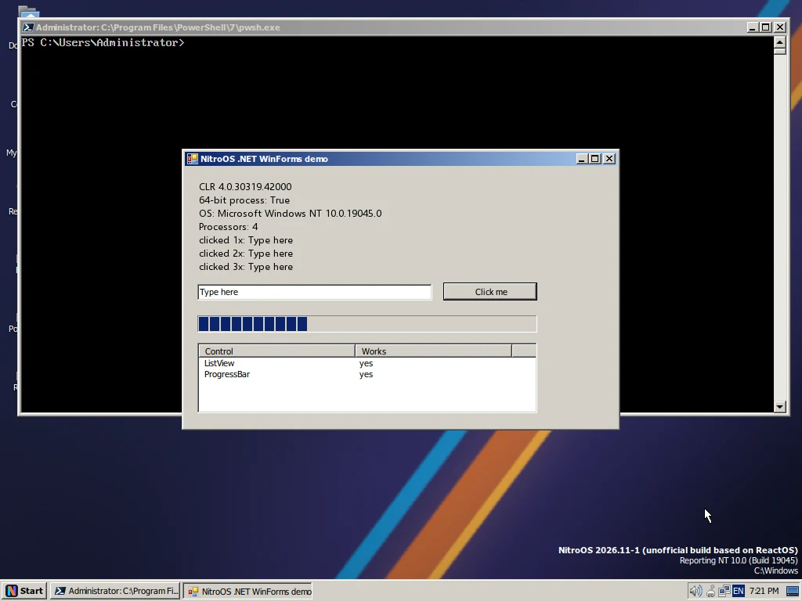</a><br>A .NET Framework 4.8 Windows Forms program, built inside the virtual machine | <a href="docs/img/nitro-features.webp">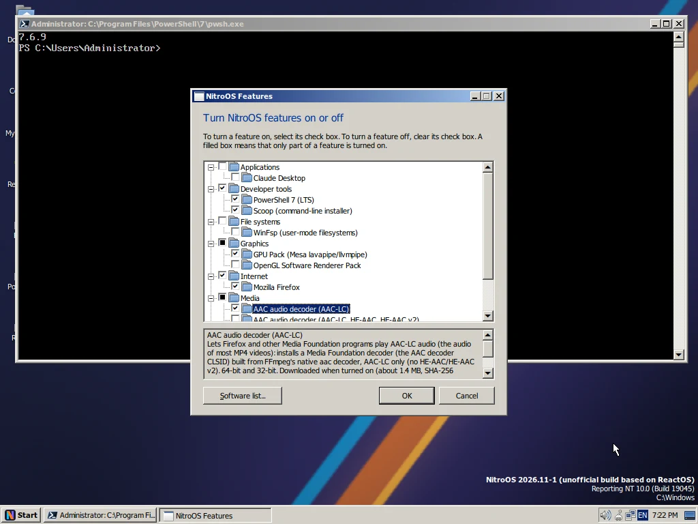</a><br>The Features dialog, for installing optional components |
| <a href="docs/img/nitro-features-installing.webp">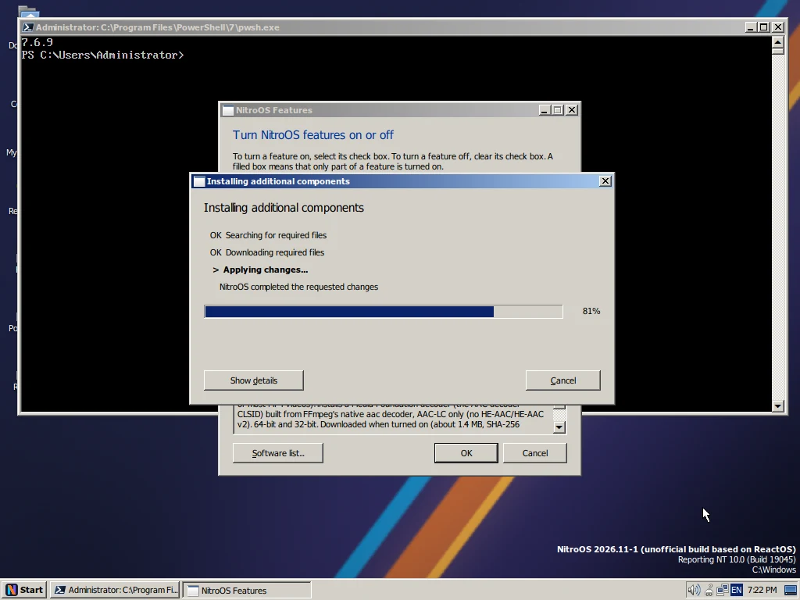</a><br>Features installing the selected components | <a href="docs/img/nitro-format.webp">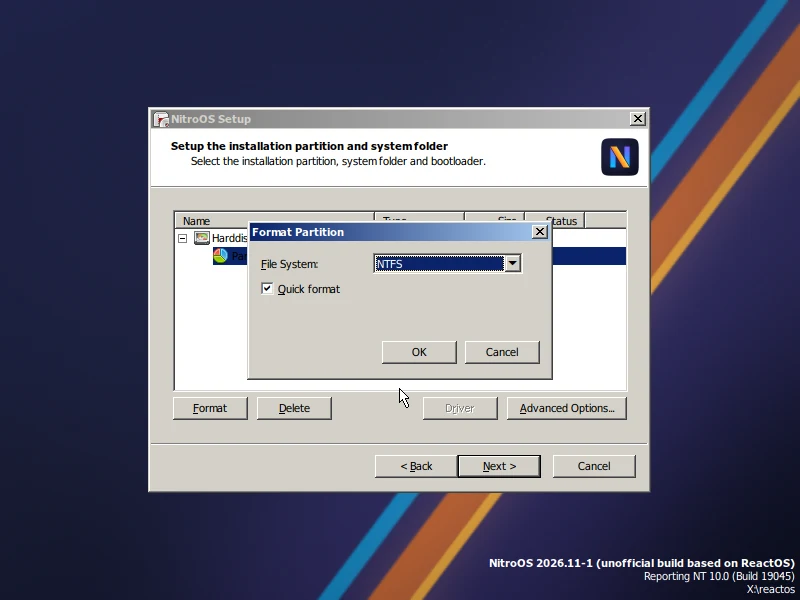</a><br>Setup, with NTFS selected |
| <a href="docs/img/nitro-install.webp">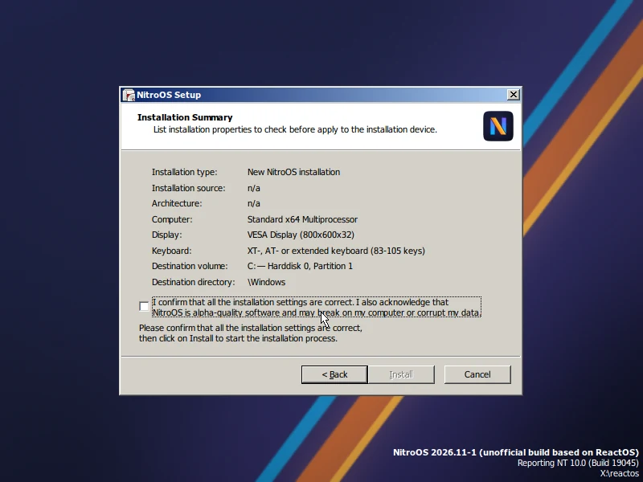</a><br>Setup summary: multi-processor kernel, installing to `\Windows` | <a href="docs/img/nitro-firewall.webp">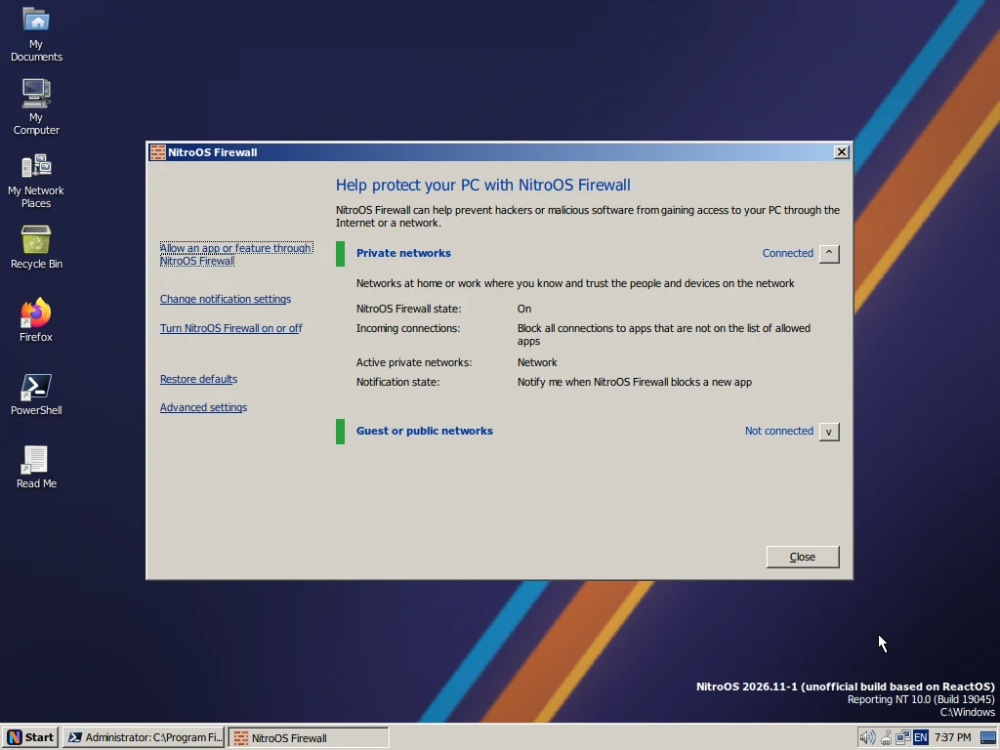</a><br>NitroOS Firewall, switched on after a fresh install |

## Technical details

For developers: the main changes and notable bug fixes in 2026.11-1, grouped by area. The release contains 592 changes in total; the [changelog](CHANGELOG.md) lists every one, with a link to its commit.

### Memory manager and cache

NitroPager is on by default on amd64: it trims working sets and pages out private memory, with a low-water balancer and its own test suite (i386 keeps it off; `NitroPager=0` turns it off). The commit limit is RAM plus the paging files. Placeholder memory (`NtAllocateVirtualMemoryEx`) is supported.

- A section view fault builds its page tables before it takes the segment lock. This removes a lock-order deadlock with the lazy writer at low memory (bugcheck 0x7A).
- `CcCopyRead` and `CcCopyWrite` keep the shared cache map referenced during the call; the lazy writer could delete it underneath them (bugcheck).
- A driver image load waits for the balancer, for a limited time, instead of failing or taking an unusable page.

<sub>Bug fixes in this area: 44</sub>

### Heap and locks

`RtlEnterCriticalSection` spins up to the section's spin count before it waits, without jumping ahead of queued waiters, and user-mode heaps get a small-block front end. Under contention, the heap is about 30 times faster.

### Kernel, scheduler and exceptions

Foreground boost and quantum changes, amd64 user hardware breakpoints and debug registers, XState contexts that match Windows, QPC in user mode, `NtSetInformationKey`, and `NtAlertThreadByThreadId` / `NtWaitForAlertByThreadId`.

- `NtCreateThread` captures the CONTEXT and INITIAL_TEB once and checks them before the process handle.
- A ready foreground thread waiting behind a busy background thread of the same priority gets a boost that decays.
- A terminating thread runs at low real-time priority, so `TerminateProcess` on an idle-priority process under load finishes promptly.

<sub>Bug fixes in this area: 56</sub>

### WoW64 (32-bit programs on 64-bit)

System call overhead drops from about 245 ns to about 92 ns: plain system calls skip FXSAVE, and APC dispatch and `Get/SetThreadContext` read the live x87/SSE state instead. Also: the 32-bit debug API, the WOW64 TEB offset, thread context in 64-bit code, extended handle information, SCSI/ATA pass-through and an allow-list of 336 ioctls that carry no pointers.

- The remaining 32-bit COM servers (DirectDraw, DirectSound, DirectInput, UI Automation, MSHTML, HTML Help, ADSI) are registered in the 32-bit registry view.
- The crash reporter runs in SysWOW64, and `ExitWindowsEx` and console control events are forwarded.

<sub>Bug fixes in this area: 52</sub>

### NTFS and FAT

NTFS-NG commits its journal without holding the core lock, supports POSIX delete, reuses MFT records, runs chkdsk/autochk, and sends non-cached writes straight to the device in requests of up to 1 MB (AHCI sequential writes went from 205 to 358 MB/s in our test). The FAT checker is synced to dosfstools 4.2.

- NTFS-NG re-zeroes only the page that contains the old end of the file. Before, growing a file by appending re-zeroed every page (60 to 77 s in one test).
- Byte-range locks belong to their file object: unlocking through one handle no longer releases locks taken through another.
- fastfat updates the volume state atomically and clears the create-in-progress flag after an exception; before, the next create could bugcheck with 0x23.

<sub>Bug fixes in this area: 37</sub>

### Display, compositor and win32k

Windows.UI.Composition stages 0 to 3 (the visual tree) and a minimal DirectComposition, enough for WebView2 controllers and Edge to render, with Edge's default sandbox. DirectWrite font fallback, per-desktop win32k work and `UpdateLayeredWindow`.

- `SetParent` works on another process' window, as on Windows.
- Window message behaviour is closer to Windows 10, measured on a reference Windows installation.
- Pattern fills honour the DC brush origin in the 8, 16, 24 and 32 bpp blitters.

<sub>Bug fixes in this area: 41</sub>

### Networking and firewall

NitroOS Firewall is on by default: inbound and outbound filtering, a rule store in the Windows registry format, firewall.cpl, wf.msc and a block prompt. Fixes to the TCP receive window and loopback, the AFD send window and shutdown, `WSASendMsg`, `netsh portproxy`, the HTTP Server API and schannel; `ipconfig` and `net.exe` print what Windows prints.

- `SO_RCVTIMEO` applies to datagram sockets too; a UDP receive with a timeout used to wait forever.
- The firewall indexes address files by port (finding the owner of an inbound connection is about 7 times cheaper), and address files keep a reference to the process that created them.

<sub>Bug fixes in this area: 48</sub>

### Console and terminal

ConPTY and VT input: the pseudoconsole that VS Code, Windows Terminal and PowerShell 7 use.

- Ctrl+C copies when text is selected, Ctrl+V pastes and Ctrl+A selects all; QuickEdit is on by default, as on Windows 10.
- Console programs that own windows receive `WM_QUERYENDSESSION` and `WM_ENDSESSION` at shutdown instead of being killed first.

<sub>Bug fixes in this area: 24</sub>

### Applications, COM and Wine 11.21

Synced to Wine 11.21: 55 modules plus comctl32, mshtml, jscript, msxml3/4, urlmon, ieframe and msvcrt. PowerShell 7 is preinstalled with clean-room NetAdapter, NetTCPIP, DnsClient, Storage, ScheduledTasks and LocalAccounts modules. Office Click-to-Run installs; Word itself still stops at its splash screen.

- msxml3 XPath understands prefixed function calls such as `ms:string-compare`.
- `DirectPlay8Create` returns working objects (dplayx and dpnet synced).

<sub>Bug fixes in this area: 157</sub>

### Locale data

The 146 locale tables and the calendar data are generated from Unicode CLDR 49 by a deterministic generator in the source tree (`sdk/tools/nlsgen`). Nothing is taken from Windows.

### Setup, storage and drivers

New installations go to `C:\Windows`, with a junction. The i386 live setup runs with DMA (about 1 minute to install in our test VM). New NVMe storport miniport. Gecko, AAC and the graphics pack install on demand from Features.

- usbport: two CPUs flushing transfers at the same time no longer map one transfer twice (which caused an endless list walk).
- i386 Debug installations work again (the driver-install lock is a mutex, and TOKEN_USER buffers are aligned).

<sub>Bug fixes in this area: 29</sub>

### Security and build

Security descriptors on the registry and eight grouped sets of hardening fixes (file-system links, loader and path handling, LSA, win32k USER, networking and more; details are withheld until users have had time to update). The amd64 Release binaries are free of the SEH `__finally` code-generation defect (38 functions were affected; verified by a scan).

<sub>Bug fixes in this area: 39</sub>

## Next release: 2026.11-2

What we are working on now. These are goals, not promises: the release notes will say what made it in.

| Area | Status | Goal |
|---|---|---|
| Faster | in progress | Speed up the file system, cached writes and process start. Listing a large folder is already about 15 times faster in the development version. Our goal for 2026.12-1 is to match or beat Windows 10 across our benchmarks. |
| Memory | in testing | When paging is on, programs will be able to use up to the size of RAM plus the paging file. This is in final testing. |
| Locales | done | Date, number and currency formats closer to Windows, still built from Unicode's public data: 13 of the 26 lines in our .NET test now match Windows exactly, up from 8. |
| Drivers and virtual machines | done | Better driver support (interrupts for KMDF drivers, a log of missing driver functions, process and thread callbacks), and the system disk grows automatically when you enlarge a virtual disk. |
| Security | ongoing | Daily security hardening across the kernel, the graphics subsystem and networking. |
| Office | in progress | Work on the Windows composition interfaces that Word needs. Today, Word still stops at its splash screen. |

## Download

Release `2026.11-1` comes in two versions: 64-bit (which also runs 32-bit programs) and 32-bit. The ISO files are hosted on repo.nitroos.org; check them against `SHA256SUMS`.

| File | Size | SHA-256 |
|---|---|---|
| [reactos-nitro-2026.11-1-amd64-wow64-Release.iso](https://repo.nitroos.org/releases/nitro-2026.11-1/reactos-nitro-2026.11-1-amd64-wow64-Release.iso) | 800,063,488 bytes | `1f12edc4e134299f7f4341f64f7d171872b88f00bfaed03399b2103524d7f14f` |
| [reactos-nitro-2026.11-1-i386-Release.iso](https://repo.nitroos.org/releases/nitro-2026.11-1/reactos-nitro-2026.11-1-i386-Release.iso) | 472,907,776 bytes | `ddfb5a43768d44b5c45ae7c588252afc7e587db0ba9cce01b452d0defef4011e` |
| [SHA256SUMS](https://repo.nitroos.org/releases/nitro-2026.11-1/SHA256SUMS) | | |

The source code and a single patch against the ReactOS base are attached to the [GitHub release](https://github.com/nitroos-org/releases/releases/tag/nitro-2026.11-1) (`reactos-nitro-2026.11-1-src.tar.gz`, `nitro-2026.11-1-over-e46f4bb1a1e.cumulative.patch`). Older releases: [`repo.nitroos.org/releases/`](https://repo.nitroos.org/releases/).

Choose the 64-bit ISO unless you need a 32-bit system; all screenshots on this page are from the 64-bit version.

## Quick start

1. Create a virtual machine. We tested with QEMU/KVM: machine `pc` (i440fx), SeaBIOS, 2 to 4 virtual CPUs, 2 to 4 GB of memory, an IDE disk of 8 GB or more, an `e1000` network card and standard VGA. Other hypervisors and real hardware are untested.

   ```sh
   qemu-img create -f raw nitroos.img 20G
   qemu-system-x86_64 -machine pc,accel=kvm -cpu host -smp 4 -m 4096 \
     -drive file=nitroos.img,format=raw,if=ide \
     -drive file=reactos-nitro-2026.11-1-amd64-wow64-Release.iso,media=cdrom,if=ide \
     -boot order=d -netdev user,id=n0 -device e1000,netdev=n0 \
     -device VGA -usb -device usb-tablet
   ```

2. Boot from the ISO, click **Install** and accept the defaults (NTFS is already selected). Setup restarts once to finish, then starts the desktop. Some installer text may still say "ReactOS" (see the known limitations).
3. On first boot, cancel the "Other ACPI device" wizard. A *Choose Your Web Browser* window offers to install Firefox, which it downloads through Features.
4. To change the screen resolution, right-click the desktop and choose **Properties**, then **Settings**. In our VM the list offered 800x600, 1024x600, 1024x768, 1152x864 and more.
5. **Features** (Run: `optfeatures`) installs PowerShell 7, Scoop, .NET Framework 4.8, Wine Gecko, the AAC decoder and more. With Scoop you can then install other software, for example `scoop install git`, `scoop bucket add extras` and `scoop install vscode googlechrome`.

## Known limitations

From the 2026.11-1 release notes and our own testing:

- NitroOS is alpha software and has been tested only in QEMU/KVM virtual machines. Real hardware is untested; in particular, the interrupt handling for real multi-processor machines (the APIC HAL) is not covered.
- The ReactOS name still appears in some places; we have not checked every dialog and installer page.
- In a 1 GB virtual machine, one program can use about 768 MB of memory; a 1,400 MB allocation fails cleanly. Running a 1,400 MB program and a `git clone` at the same time still fails in 4 of 9 tries.
- NTFS is slow with large folders and many small files: 20 listings of a 10,000-file folder take 2.19 s on 64-bit, and reading 10,000 small files takes 2.38 s. Cached sequential writes reach 45 MB/s. All three are being worked on for 2026.11-2.
- Word installs but stops at its splash screen.
- The VS Code terminal draws garbled text with its default GPU renderer in most launches. Workaround: set `terminal.integrated.gpuAcceleration` to `off`.
- User Interface Privilege Isolation (UIPI) is missing, so windows at different integrity levels can send each other messages. Do not let untrusted people log on to a NitroOS machine.
- Running 32-bit programs is supported on the 64-bit version only.
- Everything in ReactOS's own list of known issues also applies.

## Build from source

Every release is tagged in the development repository: [`nitro-2026.11-1`](https://github.com/nitroos-org/reactos/releases/tag/nitro-2026.11-1) in [nitroos-org/reactos](https://github.com/nitroos-org/reactos). The source tarball and the cumulative patch are attached to the release; applying the patch to upstream `e46f4bb1a1e` with `git apply --binary` gives exactly the tagged tree. Build it as you would build ReactOS, with the ReactOS Build Environment (RosBE). For the 64-bit version that runs 32-bit programs, add `-DBUILD_WOW64_ENABLED=ON -DSYSWOW64=ON`; a 64-bit Release build without `SYSWOW64` hangs during unattended installation.

## Relationship to ReactOS

NitroOS is built on [ReactOS](https://reactos.org): the kernel, the Win32 subsystem and most of the user mode come from the ReactOS project and its contributors, and we merge the latest ReactOS code regularly (this release did not include a new merge; it is based on `e46f4bb1a1e` from 25 October 2026). [UPSTREAM.md](UPSTREAM.md) explains what we change and why NitroOS has its own NTFS driver. NitroOS is not the ReactOS project and is not supported by it; please report NitroOS bugs in this repository. "ReactOS" is a trademark of the ReactOS project. "Windows" and the other product names in screenshots belong to their owners and are used only to show what NitroOS is compatible with.

## Licence

NitroOS uses the same licences as ReactOS, mainly GPL-2.0-or-later. Each file keeps its own licence and copyright notices. The test program `docs/demo/app.cs` is our own and is released into the public domain (CC0). The logo files in `docs/img/brand/` are NitroOS artwork.

## Credits

NitroOS stands on the work of many open-source projects. Thank you.

- **[ReactOS](https://reactos.org)**: the ReactOS project and its contributors. NitroOS is built on their kernel, Win32 subsystem and most of the user mode, and we merge their latest changes regularly.
- **[Wine](https://www.winehq.org)**: whose libraries ReactOS and NitroOS reuse (updated to Wine 11.21 in this release).
- **[Linux NTFS driver](https://www.kernel.org)**: its authors; it is the core of NitroOS's NTFS support.
- **[WinBtrfs](https://github.com/maharmstone/btrfs)**: Mark Harmstone's Btrfs driver and tools.
- **[Unicode CLDR and ICU](https://cldr.unicode.org)**: the Unicode Consortium's locale data, from which our locale tables are generated, and ICU 64.2.
- **[Mesa, LLVM and the Vulkan loader](https://www.mesa3d.org)**: software OpenGL and Vulkan in the optional graphics pack.
- **[FFmpeg](https://ffmpeg.org)**: the optional AAC audio decoders.
- **[WinFsp](https://winfsp.dev)**: Bill Zissimopoulos's framework for file systems that run as ordinary programs (an optional feature).
- **[dosfstools](https://github.com/dosfstools/dosfstools)**: the FAT disk checker.
- **[PowerShell and Scoop](https://github.com/PowerShell/PowerShell)**: PowerShell 7, preinstalled from Microsoft's official package, and the Scoop package manager (an optional feature).
- **[mingw-w64](https://www.mingw-w64.org)**: public headers, one of our clean sources for interface definitions.
- **[Fonts](https://fonts.google.com/noto)**: Selawik, Carlito, Caladea, Noto Sans CJK, Noto Sans Symbols 2 and Noto Emoji, under the SIL Open Font License.

NitroOS uses the same licences as ReactOS, mainly GPL-2.0-or-later. Every file keeps its own licence and copyright notices, and the third-party licence texts are on the installation CD. The full list, with versions and licences, is in [`media/doc/3rd Party Files.txt`](https://github.com/nitroos-org/reactos/blob/main/media/doc/3rd%20Party%20Files.txt).
